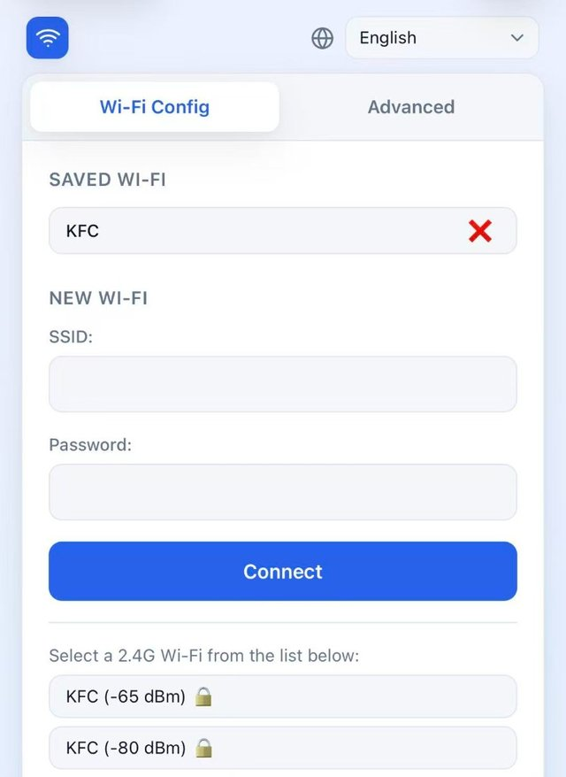

# ESP32 Wi-Fi Connect

This component helps with Wi-Fi connection for the device.

It first tries to connect to a Wi-Fi network using the credentials stored in the flash. If this fails, it starts an access point and a web server to allow the user to connect to a Wi-Fi network.

The URL to access the web server is `http://192.168.4.1`.

### Screenshot: Wi-Fi Configuration v3.2



## Version 4.0.0

- Advanced settings accepts application-defined groups with typed fields, optional translations, and load/save callbacks.
- The component includes the Wi-Fi group. Applications upgrading from 3.x can register their own OTA and sleep groups and continue using their existing NVS keys.
- The application settings page uses browser-native controls and works with the configuration AP offline.

## Changelog: v3.3.3

- Add optional screen-dim and power-off timer overrides to the Advanced tab. Validate timers before changing settings, preserve board defaults, and support restoring defaults with `null`.
- Group sleep settings, simplify labels and signal indicators, and improve mobile safe-area handling. Show localized save confirmation above the Save button so captive-portal windows cannot clip a fixed bottom toast.
- Complete the portal's 38 language catalogs, localize validation and request failures, update feedback when switching languages, and support right-to-left layouts.

## Changelog: v3.3.2

- Validate custom OTA URLs in the config portal and its save endpoint. Empty values select the application's default; nonempty values must be absolute HTTP(S) URLs of at most 255 ASCII bytes, with a host and a valid nonzero port when specified. Percent-encode non-ASCII characters.
- Reject invalid OTA settings before modifying NVS, and clear stale/autofilled input when loading an empty configuration.
- Ignore invalid OTA URLs already in NVS when opening the portal. Applications reading `wifi/ota_url` directly should use `wifi_config::IsValidOtaUrl()` from `ota_url.h` and fall back to their default URL when it returns false. This also covers devices that connect without reopening the portal. Valid custom URLs and existing NVS keys are preserved.

## Changelog: v3.3.1

- Bound SSID/password copies into `wifi_config` so a full 32-byte SSID no longer overflows with `strcpy`.
- Config portal and SmartConfig now handle a maximum-length SSID without truncating or reading past the buffer.

## Changelog: v3.3.0

- Persist each saved AP's channel in NVS as `channel`, `channel1`, ... `channel9` (same indexing as `password` / `passwordN`). 2.4 GHz (1-14) and 5 GHz (36-177) share one `uint8` key because the channel numbers do not overlap.
- The first station scan after start only visits those saved channels. If no matching AP is found, the next scan is a full-band scan.
- After a successful connection, the current channel is written back so later boots stay accurate if the AP moved.

## Changelog: v3.2.0

- Station mode now connects to the strongest same-SSID AP. `StartConnect()` sets `WIFI_ALL_CHANNEL_SCAN` + `WIFI_CONNECT_AP_BY_SIGNAL` on the station config so the driver picks the AP with the best signal instead of the first match it finds (the previous default was `WIFI_FAST_SCAN`).
- Added `station_failure_retry_cnt` (default: 3) to `WifiManagerConfig`. The driver retries the strongest AP this many times before falling back to a weaker same-SSID AP, avoiding spurious fallback on a single transient auth failure.
- Added `show_ota_config` and `show_sleep_config` flags to `WifiManagerConfig`. Both default to `false`, hiding the corresponding fields in the config portal Advanced tab. Set them to `true` to make the fields visible.

## Changelog: v3.1.0

- Event callback now includes an additional `data` parameter for extra information.
- Disconnected event now provides the disconnect reason code via the `data` parameter.
- This allows applications to handle different disconnect scenarios appropriately.

## Changelog: v3.0.0

- Added WifiManager class for unified WiFi connection management.
- Improved DnsServer and WifiConfigurationAp classes for better resource handling.
- Updated HTML for configuration success message to use exit endpoint instead of reboot.
- Enhanced error handling and state management in WifiStation.
- Cleaned up unused code and improved thread safety across components.

## Changelog: v2.6.0

- Add support for ESP32C5 5G mode.

## Changelog: v2.4.0

- Add ja / zh-TW languages.
- Add advanced tab.
- Add "Connection: close" headers to save open sockets.

## Changelog: v2.3.0

- Add support for language request.

## Changelog: v2.2.0

- Add support for ESP32 SmartConfig(ESPTouch v2)

## Changelog: v2.1.0

- Improve Wi-Fi connection logic.

## Changelog: v2.0.0

- Add support for multiple Wi-Fi SSID management.
- Auto switch to the best Wi-Fi network.
- Captive portal for Wi-Fi configuration.
- Support for multiple languages (English, Chinese).

## Configuration

The Wi-Fi credentials are stored in the flash under the "wifi" namespace.

The keys are "ssid", "ssid1", ... "ssid9", "password", "password1", ... "password9", and "channel", "channel1", ... "channel9". Channel is a `uint8` (0 = unknown; 1-14 = 2.4 GHz; 36-177 = 5 GHz).

## Usage

### Host regression tests

Run the portal tests with Node.js and the settings API tests with a C/C++ compiler. Set `CJSON_DIR` to the directory containing `cJSON.c`.

```sh
node --test tests/test_portal.js
CJSON_DIR=/path/to/cJSON python3 -m unittest discover -s tests -v
```

```cpp
#include <wifi_manager.h>
#include <ssid_manager.h>

// Initialize the default event loop
ESP_ERROR_CHECK(esp_event_loop_create_default());

// Initialize NVS flash for Wi-Fi configuration
esp_err_t ret = nvs_flash_init();
if (ret == ESP_ERR_NVS_NO_FREE_PAGES || ret == ESP_ERR_NVS_NEW_VERSION_FOUND) {
    ESP_ERROR_CHECK(nvs_flash_erase());
    ret = nvs_flash_init();
}
ESP_ERROR_CHECK(ret);

// Get the WifiManager singleton
auto& wifi_manager = WifiManager::GetInstance();

// Initialize with configuration
WifiManagerConfig config;
config.ssid_prefix = "ESP32";  // AP mode SSID prefix
config.language = "zh-CN";     // Web UI language

// Optional: tune connection-to-strongest-AP behavior
// config.station_failure_retry_cnt = 3;  // retries before falling back to weaker AP

// Optional: register application settings before Initialize.
// config.advanced_groups.push_back(MakeApplicationSettingsGroup());

wifi_manager.Initialize(config);

// Set event callback to handle WiFi events
// The callback receives the event type and optional data (e.g., disconnect reason)
wifi_manager.SetEventCallback([](WifiEvent event, const std::string& data) {
    switch (event) {
        case WifiEvent::Scanning:
            ESP_LOGI("WiFi", "Scanning for networks...");
            break;
        case WifiEvent::Connecting:
            ESP_LOGI("WiFi", "Connecting to network...");
            break;
        case WifiEvent::Connected:
            ESP_LOGI("WiFi", "Connected successfully!");
            break;
        case WifiEvent::Disconnected:
            // data contains the disconnect reason code
            ESP_LOGW("WiFi", "Disconnected from network, reason: %s", data.c_str());
            break;
        case WifiEvent::ConfigModeEnter:
            ESP_LOGI("WiFi", "Entered config mode");
            break;
        case WifiEvent::ConfigModeExit:
            ESP_LOGI("WiFi", "Exited config mode");
            break;
    }
});

// Check if there are saved Wi-Fi credentials
auto& ssid_list = SsidManager::GetInstance().GetSsidList();
if (ssid_list.empty()) {
    // No credentials saved, start config AP mode
    wifi_manager.StartConfigAp();
} else {
    // Try to connect to the saved Wi-Fi network
    wifi_manager.StartStation();
}
```

Please check https://github.com/78/xiaozhi-esp32 for more usage.


## Application settings groups

Add application groups to `WifiManagerConfig::advanced_groups` before calling
`Initialize`. Each group declares a unique ID, an English title and optional
help, and an ordered list of fields. Use a stable, identifier-style ID for each
group, field, and option. The built-in Wi-Fi group reserves the ID `wifi`.

The default widgets are text for `Text`, a number input for `Integer`, a switch
for `Boolean`, and multi-select checkboxes for `TextList`. Use `TextArea` for
multiline text, `Select` and `Radio` for typed options, and `Copy` for a read-only
text value. Set `enabled_by` to the ID of a Boolean field to show a dependent
control only when that field is on. Use `clearable` on an editable text field to
let users clear it and save an empty value.

`load()` supplies the displayed values. A save callback sees only edited fields.
A blank optional integer is `nullptr`, zero is an integer, and clearing a
multi-select submits an empty vector. A field error can include a translation
key. Return an empty `SaveResult` after persisting a valid change. Callbacks run
on the portal's HTTP server task and should return promptly.

Optional translations use a static array of `Translation` entries. The locale
matches the portal dropdown. Keys include `title`, `help`, `port.label`,
`port.help`, `port.unit` and `port.options.example.label`. English text comes
from the declarations when a translation is missing.

```cpp
using namespace wifi_config;

static constexpr Translation translations[] = {
    {"zh-CN", "title", "服务"},
    {"zh-CN", "port.label", "端口"},
};

config.advanced_groups.push_back({
    .id = "service",
    .title = "Service",
    .fields = {{.id = "port", .type = FieldType::Integer, .label = "Port",
                .required = true, .min = 1, .max = 65535}},
    .translations = translations,
    .load = LoadServiceSettings,
    .save = SaveServiceSettings,
});
```
